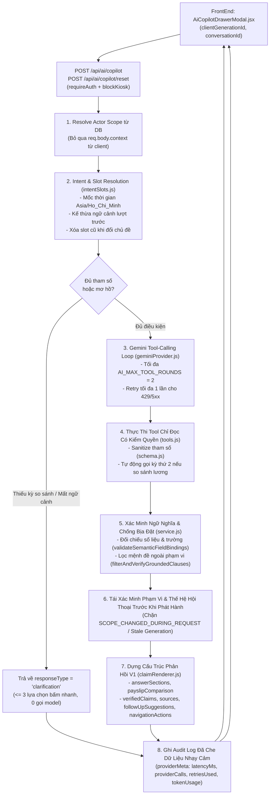

# AI_V1_ARCHITECTURE — Kiến Trúc Trợ Lý Nhân Sự AI NEXUS HRMS V1 (Chỉ Đọc, Có Nguồn Đối Chiếu)

- **Dự án**: `C:\Users\tavin\Downloads\QLDACNTT`
- **Nhánh triển khai**: `feature/ai-v1-grounded-vietnamese` (tách từ `develop`)
- **Phạm vi**: Trợ lý nhân sự AI NEXUS HRMS V1 chỉ đọc (`Read-only`), trả lời tiếng Việt tự nhiên có nguồn đối chiếu (`sources`), hỗ trợ hỏi tiếp ngắn gọn (`follow-up`), hỏi lại làm rõ (`clarification`) và so sánh phiếu lương giữa 2 kỳ đã công bố.

---

## 1. Sơ Đồ Luồng Xử Lý Tổng Thể (End-to-End Flow)



---

## 2. Cấu Trúc Mô-đun Backend & Frontend

| Thành phần | Đường dẫn | Trách nhiệm chính |
|---|---|---|
| **Hợp đồng & Kiểm tra tham số** | `Backend/src/modules/ai/schema.js` | Định nghĩa `INTENT_TYPES`, `RESPONSE_TYPES`, `ALLOWED_TOOL_ARGS`, `NAVIGATION_ACTION_ALLOWLIST`, kiểm tra payload, gợi ý câu hỏi tiếp theo và nút điều hướng theo đúng vai trò. |
| **Phân tích chủ đề & Ngữ cảnh** | `Backend/src/modules/ai/intentSlots.js` | Chuẩn hóa tiếng Việt có dấu/không dấu, giải mã thời gian tương đối theo `Asia/Ho_Chi_Minh` (`"năm nay"`, `"tháng trước"`, `"kỳ gần nhất"`), kế thừa ngữ cảnh lượt trước (`"Còn tháng trước?"`), xóa slot cũ khi đổi chủ đề và tạo `clarification` khi thiếu tham số. |
| **Trình bày câu trả lời & So sánh** | `Backend/src/modules/ai/claimRenderer.js` | Định dạng tiền tệ `VND`, ngày `dd/MM/yyyy`, số thập phân `vi-VN`; tính toán chênh lệch phiếu lương 2 kỳ (`computePayslipComparison`); dựng `answerSections` (`summary`, `details`, `calculation`, `comparison`, `limitations`). |
| **Công cụ chỉ đọc (Read-only Tools)** | `Backend/src/modules/ai/tools.js` | Thực thi 6 công cụ chỉ đọc có kiểm tra RBAC tại tầng dữ liệu, lọc prompt injection từ `handbook_docs`, ưu tiên kỳ đã công bố (`DA_CHOT`/`DA_CHUYEN_KHOAN`) khi hỏi `"gần nhất"`. |
| **Kết nối Gemini API** | `Backend/src/modules/ai/geminiProvider.js` | Gọi Gemini `generateContent` với `AbortController` timeout, retry tối đa 1 lần cho lỗi tạm thời (`429`, `502`, `503`, `504`), thu thập `_providerStats` (`providerCalls`, `retriesUsed`, `tokenUsage`). |
| **Điều phối & Xác minh trung tâm** | `Backend/src/modules/ai/service.js` | Quản lý lịch sử hội thoại theo `scopeFingerprint` và `scopeGeneration`, điều phối vòng lặp công cụ, kiểm chứng `structuredEvidence`, chặn rò rỉ dữ liệu khi đổi quyền giữa chừng. |
| **Quản lý trạng thái UI** | `FrontEnd/src/utils/aiCopilotState.js` | Chuẩn hóa tin nhắn V1 (`answerSections`, `clarification`, `followUpSuggestions`, `navigationActions`), tạo gợi ý mở đầu động theo vai trò & thời gian thực, bảo vệ chống ghi đè bởi phản hồi cũ (`isStaleGenerationResponse`). |
| **Giao diện ngăn kéo AI** | `FrontEnd/src/modals/analytics/AiCopilotDrawerModal.jsx` | Hiển thị ngăn kéo AI Copilot đáp ứng (`390px` mobile / `1440px` desktop), nút `Làm mới`, chọn nhanh `clarification`, mở rộng nguồn đối chiếu, ô nhập nhiều dòng (`Enter` gửi, `Shift+Enter` xuống dòng), `aria-live="polite"`. |

---

## 3. Ma Trận Phân Quyền 6 Công Cụ Chỉ Đọc (RBAC Matrix)

Mọi quyền truy cập đều được xác định từ `req.user` đối chiếu trực tiếp cơ sở dữ liệu PostgreSQL. Trường `req.body.context` từ phía trình duyệt bị bỏ qua hoàn toàn (`ignoredClientContext = true`).

| Công cụ (`tools.js`) | `EMPLOYEE` | `LINE_MANAGER` | `HR_DIRECTOR` | `CEO` | `ADMIN` | `KIOSK` | Nguồn dữ liệu trả về (`sources`) |
|---|---|---|---|---|---|---|---|
| `get_my_leave_balance` | Chỉ bản thân (`actor.employeeId`) | Chỉ bản thân | Chỉ bản thân | Chỉ bản thân | Từ chối (`FORBIDDEN_ROLE`) | Chặn HTTP `403` | `leave_balances`, `leave_types`, `leave_requests` |
| `get_my_attendance` | Chỉ bản thân (tối đa `62` ngày) | Chỉ bản thân (tối đa `62` ngày) | Chỉ bản thân (tối đa `62` ngày) | Chỉ bản thân (tối đa `62` ngày) | Từ chối (`FORBIDDEN_ROLE`) | Chặn HTTP `403` | `attendance_logs`, `attendance_appeals` |
| `get_my_payslip` | Chỉ bản thân & kỳ đã công bố (`DA_CHOT`/`DA_CHUYEN_KHOAN`) | Chỉ bản thân & kỳ đã công bố | Chỉ bản thân & kỳ đã công bố | Chỉ bản thân & kỳ đã công bố | Từ chối (`FORBIDDEN_ROLE`) | Chặn HTTP `403` | `payslips`, `payroll_periods` |
| `search_policies` | Văn bản `is_active = TRUE` & cấu hình theo kỳ hiệu lực | Cho phép | Cho phép | Cho phép | Cho phép | Chặn HTTP `403` | `handbook_docs`, `system_settings`, `system_policy_versions` |
| `get_scoped_dashboard` | Từ chối (`FORBIDDEN_SCOPE`) | Chỉ phòng ban mình quản lý (`myDept`) | Toàn công ty hoặc theo phòng ban | Toàn công ty hoặc theo phòng ban | Từ chối (`FORBIDDEN_SCOPE`) | Chặn HTTP `403` | `dashboardService` (`department` / `all`) |
| `get_scoped_performance` | Chỉ bản thân (`scope: 'self'`) | Chỉ nhân sự thuộc phòng ban mình (ẩn chi tiết chênh lệch lương đồng cấp) | Toàn công ty | Toàn công ty | Từ chối (`FORBIDDEN_SCOPE`) | Chặn HTTP `403` | `performance_reviews`, `turnoverService` |

---

## 4. Hợp Đồng Request / Response V1 (Tương Thích Ngược 100%)

### 4.1. Request (`POST /api/ai/copilot`)
```json
{
  "message": "So sánh lương tháng 02/2026 và 01/2026 của tôi",
  "conversationId": "optional-conv-id",
  "clientGenerationId": 2,
  "resetConversation": false
}
```
- Ngoài ra hỗ trợ endpoint `POST /api/ai/copilot/reset` để xóa lịch sử hội thoại trên máy chủ và tăng `scopeGeneration`.

### 4.2. Response (`200 OK`)
Giữ nguyên toàn bộ các trường hiện có (`success`, `answer`, `verified`, `refused`, `refusalCodes`, `sources`, `structuredEvidence`, `verifiedClaims`, `toolsUsed`, `dataAsOf`, `requestId`, `conversationId`, `ignoredClientContext`, `scopeChangedMidConversation`, `scopeChangedDuringRequest`) và bổ sung các trường V1:

| Trường mới V1 | Kiểu dữ liệu | Ý nghĩa |
|---|---|---|
| `responseType` | `'answer' \| 'clarification' \| 'refusal' \| 'empty' \| 'greeting'` | Phân loại trạng thái phản hồi rõ ràng cho UI và kiểm thử. |
| `intent` | `string` | Chủ đề đã nhận diện (`leave_balance`, `attendance_summary`, `payslip_explanation`, `payslip_comparison`, `policy_search`, `scoped_dashboard`, `scoped_performance`, `greeting`, `clarification`). |
| `slots` | `object` | Các tham số đã trích xuất hoặc kế thừa (`year`, `leaveType`, `month`, `from`, `to`, `period`, `comparePeriods`, `departmentId`, `employeeId`). |
| `answerSections` | `Array<{ type, title, text, items, claimRefs, sourceRefs, verified }>` | Các khối trình bày có cấu trúc (`summary`, `details`, `calculation`, `comparison`, `limitations`). |
| `clarification` | `{ question, missingSlots, choices: Array<{ label, query }> } \| null` | Câu hỏi làm rõ kèm tối đa 3 nút chọn nhanh khi câu hỏi thiếu tham số hoặc mất ngữ cảnh. |
| `followUpSuggestions` | `string[]` | Tối đa 3 gợi ý hỏi tiếp theo đúng vai trò và chủ đề vừa tra cứu. |
| `navigationActions` | `Array<{ label, path, route }>` | Các nút mở nhanh màn hình liên quan nằm trong danh sách cho phép (`NAVIGATION_ACTION_ALLOWLIST`) theo đúng quyền RBAC. |
| `payslipComparison` | `{ periodA, periodB, deltas } \| null` | Bảng đối chiếu và chênh lệch từng khoản mục lương giữa 2 kỳ đã công bố do backend trực tiếp tính toán. |
| `providerMeta` | `{ latencyMs, providerCalls, retriesUsed, tokenUsage }` | Thông tin vận hành và chi phí gọi model (đã ẩn thông tin nhạy cảm). |

---

## 5. Quy Tắc Chống Bịa Đặt, Xử Lý Thiếu Dữ Liệu & Bảo Vệ Ngữ Cảnh

1. **Không có công cụ thì không phát hành dữ kiện nhân sự (`isAllowedToollessExchange`)**:
   - Nếu `toolsUsed.length === 0`, chỉ cho phép câu chào xã giao thuần túy hoặc câu hỏi làm rõ tham số không chứa bất kỳ con số hay khẳng định trạng thái nhân sự nào. Mọi khẳng định tự do đều bị chặn với `UNGROUNDED_ANSWER_REJECTED`.
2. **Đối chiếu trường ngữ nghĩa và số liệu (`validateSemanticFieldBindings`)**:
   - Kiểm tra từng mệnh đề để đảm bảo model không đánh tráo `entitlement` (`total_days`) thành `remaining`/`available`, không đánh tráo số liệu giữa các loại phép hoặc giữa các kỳ lương khác nhau, và không gán sai trạng thái kỳ lương (`DA_CHOT` vs `DA_CHUYEN_KHOAN` vs `DU_THAO`).
3. **Danh sách từ vựng cho phép theo công cụ (`filterAndVerifyGroundedClauses`)**:
   - Nếu model tự ý chèn thêm mệnh đề ngoài phạm vi công cụ đã gọi (ví dụ: `"Hợp đồng lao động của bạn đã bị chấm dứt"` khi chỉ gọi `get_my_leave_balance`), hệ thống tự động loại bỏ mệnh đề không có nguồn và dựng lại câu trả lời từ mẫu xác minh của máy chủ (`renderServerVerifiedTemplate`).
4. **Phân biệt rõ `0` với `null` / chưa có bản ghi / bản nháp (`DU_THAO`)**:
   - Khi kỳ lương ở trạng thái `DU_THAO` hoặc chưa có bản ghi (`found: false`, `hasRecord: false`, `missingReview: true`), trả về `responseType: 'empty'` và `verified: false`, tuyệt đối không suy diễn thiếu dữ liệu thành `0 đồng` hay `12 ngày phép`.
5. **Chống rò rỉ dữ liệu khi đổi quyền hoặc làm mới hội thoại (`scopeGeneration` & `clientGenerationId`)**:
   - Trước khi trả kết quả, backend truy vấn lại DB để kiểm tra `roleCode`, `employeeId`, `departmentId` và `is_active`. Nếu phạm vi thay đổi trong lúc chờ model phản hồi, hủy kết quả cũ và trả về `SCOPE_CHANGED_DURING_REQUEST`.
